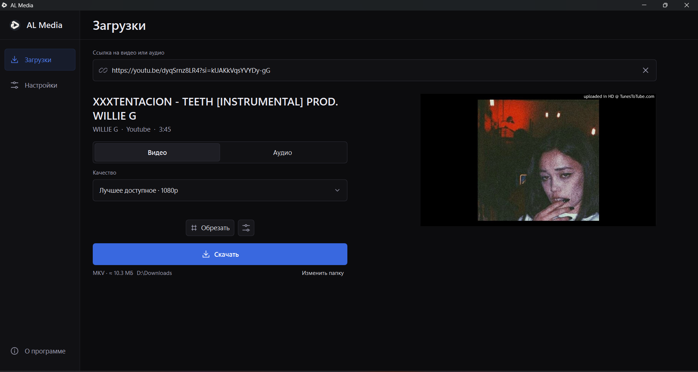
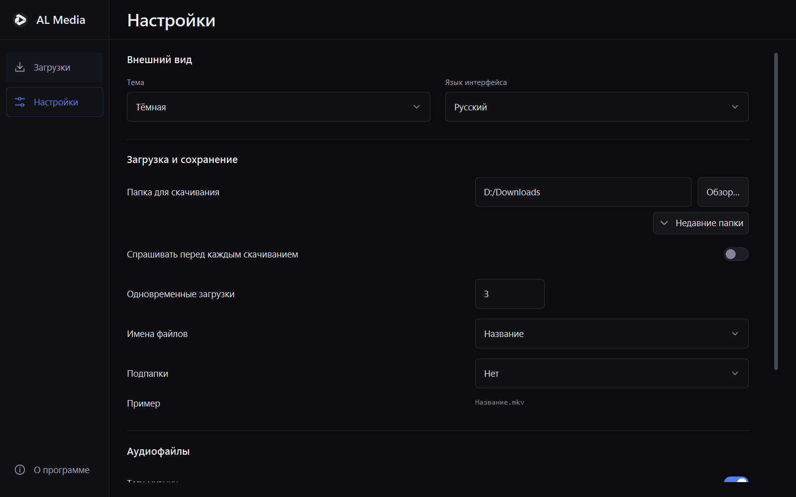
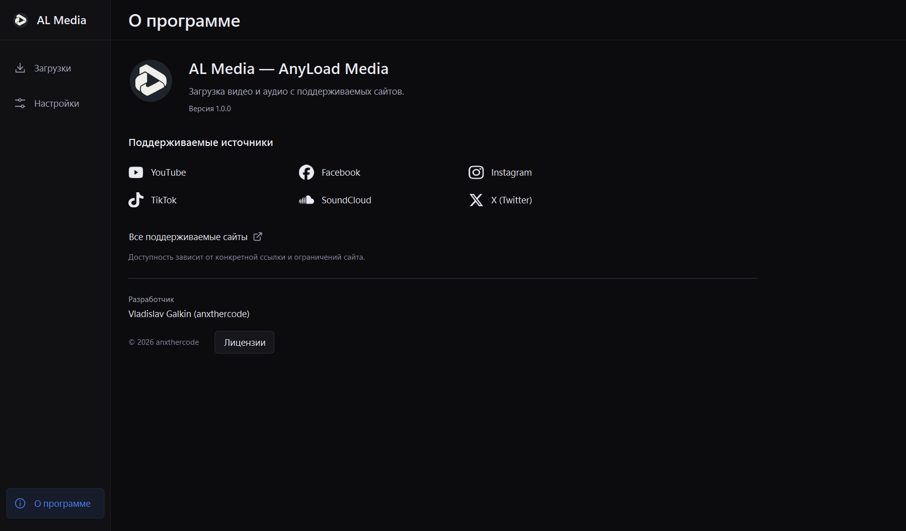

<p align="center">
  
</p>

<h1 align="center">AL Media</h1>

<p align="center">
  Скачивайте видео и музыку по ссылке.<br>
  Выбирайте качество, сохраняйте звук или нужный фрагмент — в одном приложении для Windows.
</p>

<p align="center">
  <a href="https://github.com/anxthercode/al-media/releases/latest"><b>Скачать для Windows</b></a> ·
  <a href="https://github.com/anxthercode/al-media/issues">Сообщить о проблеме</a> ·
  <a href="CHANGELOG.md">Что нового</a>
</p>

<p align="center">Версия 1.0.0 · Windows 10 / 11 · x64</p>



## Возможности

- **Видео и аудио.** YouTube, TikTok, SoundCloud и другие сайты, поддерживаемые [yt-dlp](https://github.com/yt-dlp/yt-dlp/blob/master/supportedsites.md).
- **Выбор качества.** Доступные разрешения вплоть до 4K и 8K, если их предоставляет источник.
- **Музыка.** MP3, M4A и исходный звук; сохранение тегов и обложек.
- **Обрезка.** Сохранение фрагмента с удобным вводом часов, минут и секунд.
- **Несколько загрузок.** Очередь, параллельное скачивание, списки ссылок и выбор записей из плейлиста.
- **Порядок в файлах.** Выбор папки, шаблоны имён, подпапки и открытие готовых файлов из приложения.
- **Удобный интерфейс.** Светлая, тёмная и системная темы; русский, английский, белорусский и украинский языки. Работа в трее и уведомления.

## Установка

Откройте [последний релиз](https://github.com/anxthercode/al-media/releases/latest) и выберите подходящий вариант:

| Файл версии 1.0.0 | Как использовать |
|---|---|
| `ALMedia-1.0.0-Setup-win-x64.exe` | Запустите установщик и откройте AL Media через меню «Пуск». |
| `ALMedia-1.0.0-portable-win-x64.zip` | Полностью распакуйте архив и запустите `ALMedia.exe`. |
| `ALMedia-1.0.0-SHA256SUMS.txt` | Контрольные суммы для проверки скачанных файлов. |

Нужна 64-разрядная Windows 10 или 11. Python и инструменты обработки медиа уже входят в сборку. Для portable-версии сохраняйте все папки рядом с `ALMedia.exe`.

## Как пользоваться

1. Вставьте ссылку на странице **Загрузки** — приложение автоматически получит сведения о записи.
2. Выберите **Видео** или **Аудио**, качество и, при необходимости, фрагмент.
3. Нажмите **Скачать**. Прогресс появится в списке; готовый файл можно открыть оттуда же.

Папка сохранения меняется в **Настройках**. Для нескольких записей вставьте ссылки с новой строки или перетащите текстовый файл со ссылками.

<details>
<summary>Настройки</summary>



</details>

<details>
<summary>О программе</summary>



</details>

## Если загрузка недоступна

Поддержка зависит от сайта и доступности конкретной записи. AL Media работает без входа в аккаунт и не читает cookies браузера. Закрытые записи, региональные ограничения и проверки на бота могут препятствовать загрузке.

При ошибке HTTP 429 попробуйте позже. Если проблема повторяется, [создайте обращение](https://github.com/anxthercode/al-media/issues), указав версию приложения, версию Windows, ссылку и текст ошибки.

## Запуск из исходников

Нужны Windows x64, Python 3.12 и PowerShell. Из корня репозитория:

```powershell
./scripts/bootstrap.ps1
./scripts/fetch-tools.ps1
./.venv/Scripts/python.exe main.py
```

Для сборки portable-версии используйте `./scripts/build-windows.ps1`; для установщика — `./scripts/install-inno.ps1` и `./scripts/make-installer.ps1`.

## Лицензия

[MIT](LICENSE). Условия сторонних компонентов приведены в [THIRD_PARTY_NOTICES.md](THIRD_PARTY_NOTICES.md).
